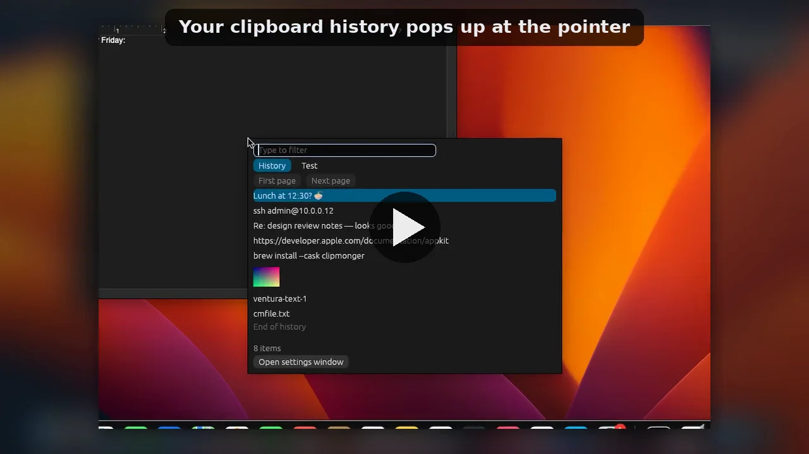
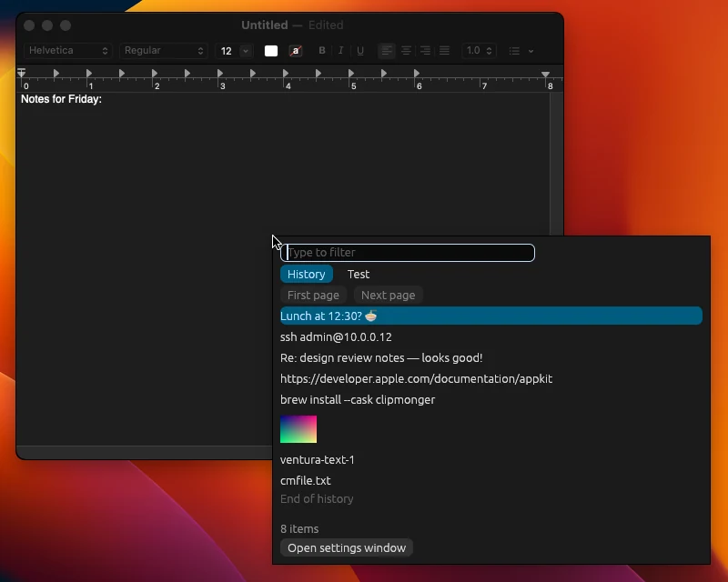
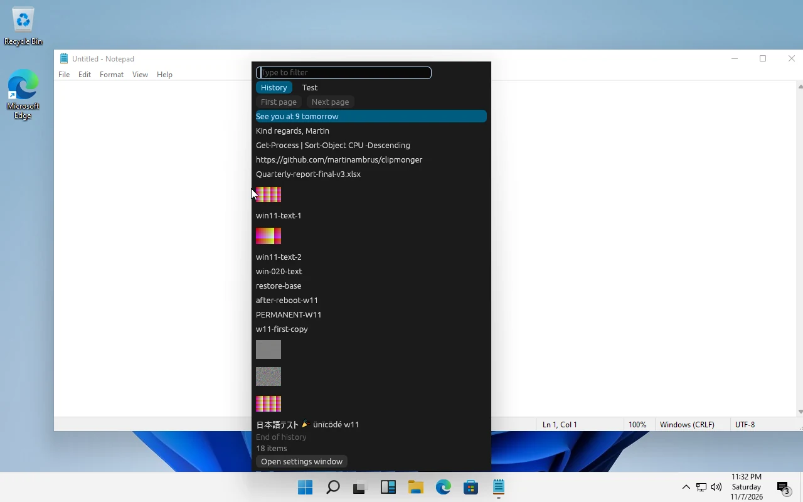
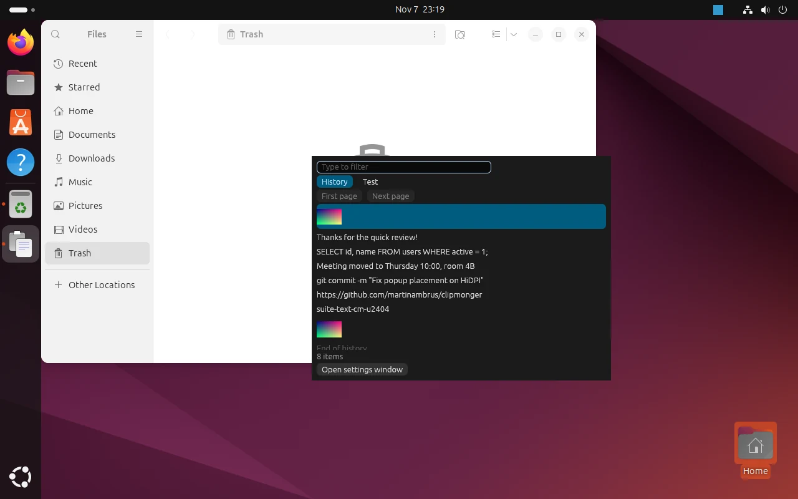
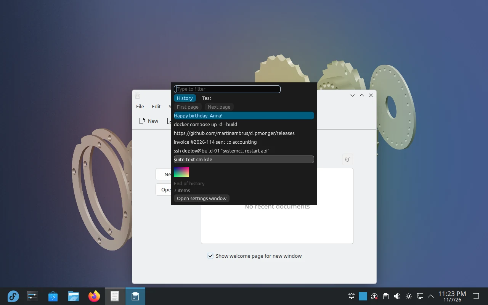
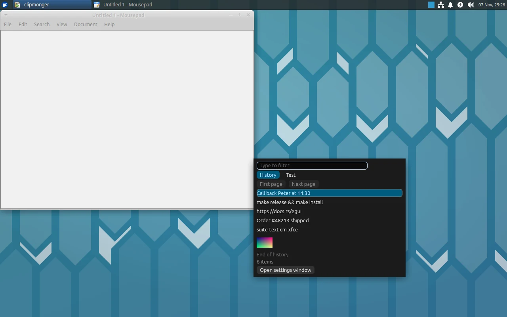
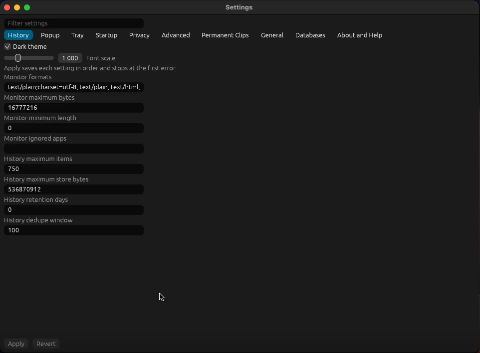

# Clipmonger

Clipmonger is a cross-platform clipboard history manager written in Rust. It
remembers everything you copy (text, images and file lists), opens a popup on
a global hotkey and pastes the clip you pick straight into the window you came
from. It runs on Windows 10/11, on macOS 10.15 and newer (Intel and Apple
Silicon), and on Linux under X11 and Wayland, including GNOME Wayland through a
bundled GNOME Shell extension.

Clipmonger is MIT-licensed. It is a modern, open successor to the classic
Windows clipboard manager ArsClip, rebuilt from scratch (no ArsClip code is
used).

> **Status: 0.3.0 pre-release.** Capture, popup, paste, permanent clips,
> Settings and start-on-login are checked before each release on Windows 10
> and 11, on macOS VMs from 10.15 to 26 and on the Linux desktops in the table
> below
> ([release regression run](tests/manual/release-regression.md)). See
> [Known limitations](#known-limitations).

<p align="center">
  <a href="docs/media/clipmonger-demo.mp4"></a>
  <br><sub>Demo video (40 s): <a href="docs/media/clipmonger-demo.mp4">docs/media/clipmonger-demo.mp4</a></sub>
</p>

| macOS (Ventura) | Windows 11 | Ubuntu GNOME |
| --- | --- | --- |
|  |  |  |
| **Fedora KDE Plasma** | **Xubuntu Xfce** | **Settings** |
|  |  |  |

## Features

### Clipboard history

- Captures text, images and file copy/cut lists continuously in the
  background, with a configurable history depth.
- Shows image thumbnails and file-list previews; large items are handled
  safely (oversized captures become visible stubs instead of failing).
- Stores history in a local SQLite database with integrity checks, plus
  backup and restore.
- Coexists with other clipboard managers and clipboard sync tools: it listens
  passively and does not take over the clipboard.
- Pause and resume monitoring from the tray, the CLI or (on Windows,
  optional) the Scroll Lock key.

### Popup

- Opens on a global hotkey (default **Ctrl+Alt+H**), from the tray icon, or
  with `clipmonger-cli show-popup`.
- Fully keyboard-driven: type to search, arrow keys to move, Enter to paste.
- Multi-line previews with a tooltip for the full text; the popup sizes itself
  to its content and the monitor.
- Pastes into the window that was active when you pressed the hotkey.

### Permanent clips

- Save snippets you use often as permanent clips, organised in named groups
  that appear as tabs in the popup.
- Give any permanent clip its own global hotkey to paste it without opening
  the popup.

### Paste delivery

- **Clipboard + Ctrl+V** (default): works for any size and format. Optionally
  restores your previous clipboard afterwards.
- **Unicode injection**: types the text as synthetic keystrokes, for targets
  that ignore Ctrl+V.
- **Windows administrator windows**: pasting into programs that run as
  administrator works through a small elevated helper, started after one
  consent and User Account Control prompt.

### Privacy

- Honours operating-system privacy signals (for example password managers
  marking a clip as sensitive), where the OS exposes them.
- Denylist of applications whose clips are never stored.
- Strict privacy mode with reduced retention.

### Settings and tooling

- A Settings window with every option on tabs (General, Popup, Privacy,
  Permanent Clips, Advanced), a search filter across all tabs and inline
  validation.
- Tray icon on Windows and Linux.
- Optional start on login.
- Portable mode on Windows: the profile is stored next to the program.
- `clipmonger-cli` for scripting: status, list and get clips, paste a clip,
  show the popup, toggle monitoring, manage permanent clips, purge removed
  clips and stop the daemon. Run `clipmonger-cli --help` for details.

### Supported platforms

| Platform | Status |
|---|---|
| Windows 10 / 11 (64-bit) | Supported, installer and portable ZIP |
| Linux x86_64, glibc 2.35+ (Ubuntu 22.04+, Debian 12+, Fedora, Arch, Mint, Pop!_OS, ...) | Supported: `.deb`, `.rpm`, or the per-user installer for any distro |
| GNOME 46 to 51 (Wayland and Xorg) | Supported via the bundled GNOME Shell extension |
| KDE Plasma 6 and 5.27 (Wayland and X11) | Supported |
| Xfce, Cinnamon and other X11 desktops | Supported |
| Sway, Hyprland, COSMIC | Supported; bind the hotkeys in the compositor (Settings shows the commands) |
| macOS 10.15 Catalina and newer (Intel and Apple Silicon) | Supported: one universal `.dmg` or `.zip` |

## Installation

Download the files from the
[latest release](https://github.com/martinambrus/clipmonger/releases/latest).

Every release has a `SHA256SUMS` file; check your download against it
(`sha256sum -c SHA256SUMS --ignore-missing` on Linux).

### Windows

1. Download `clipmonger-0.3.0-windows-x86_64-setup.exe` (or the portable
   `clipmonger-0.3.0-windows-x86_64.zip`, which keeps its data next to the
   programs).
2. Run it. The binaries are not code-signed yet, so Windows SmartScreen shows
   **Windows protected your PC**: click **More info**, then **Run anyway**.
3. Approve the User Account Control prompt and finish the installer.
4. Start Clipmonger from the Start menu and press **Ctrl+Alt+H**.

**Upgrading from an older version:** quit Clipmonger (tray icon, Exit), uninstall it in
Settings, Apps (leave "Delete my default Clipmonger profile" unticked to keep
your history), then run the new installer. The installer does not install
over an existing copy.

The full walk-through, including browser download warnings, checksum
verification and Windows 11 Smart App Control, is in
[Installing on Windows](docs/install-windows.md).

### Linux

Pick one of the three. All of them need an x86_64 system with glibc 2.35 or
newer, and all keep your history in `~/.local/share/clipmonger`.

**Ubuntu, Debian, Mint, Pop!_OS (`.deb`):**

```sh
sudo apt install ./clipmonger_0.3.0-1_amd64.deb
```

**Fedora, openSUSE and other RPM distros (`.rpm`):**

```sh
sudo dnf install ./clipmonger-0.3.0-1.x86_64.rpm
```

The packages are not signed yet, so the package manager may warn about a
missing signature; check the file against `SHA256SUMS` first.

**Any distro, no root (per-user install into `~/.local`):**

```sh
curl -fsSL https://github.com/martinambrus/clipmonger/releases/latest/download/install.sh | sh
```

Without curl (Debian ships without it): `wget -qO-
https://github.com/martinambrus/clipmonger/releases/latest/download/install.sh | sh`.
The script downloads the release tarball, checks it against `SHA256SUMS`, and
installs the programs to `~/.local/opt/clipmonger`, the commands to
`~/.local/bin`, the menu entry and, on GNOME, the Shell extension. You can
also download `clipmonger-0.3.0-linux-x86_64.tar.gz`, extract it and run
`sh install.sh`. Set `CLIPMONGER_VERSION=0.3.0` to install a specific
release.

Then start **Clipmonger** from the applications menu, or run `clipmonger`.
The UI starts its background daemon. Press **Ctrl+Alt+H** to open the popup.
On KDE Plasma, approve the shortcut in the dialog Plasma shows the first
time.

**GNOME:** the bundled GNOME Shell extension handles capture, the hotkey and
paste on Wayland (on Xorg it is optional). After installing, log out and back
in once, then enable it:

```sh
gnome-extensions enable clipmonger@extensions.clipmonger.dev
```

**Removing it:** quit Clipmonger first (tray icon, Exit), then
`sudo apt remove clipmonger`, `sudo dnf remove clipmonger`, or
`sh ~/.local/opt/clipmonger/install.sh --uninstall` for the per-user install.
Your history stays in `~/.local/share/clipmonger`; delete that folder to
remove it too.

**Sway, Hyprland and COSMIC** don't let apps register global shortcuts or run
XDG autostart entries, so bind the keys and the login start in the
compositor's own config. Settings shows the exact commands for your install
(Popup and Startup tabs; Permanent Clips has **Copy shortcut command** for each
clip). For Sway, with the default profile:

```
bindsym Ctrl+Alt+h exec clipmonger-cli --profile-dir ~/.local/share/clipmonger show-popup
bindsym Ctrl+Alt+k exec clipmonger-cli --profile-dir ~/.local/share/clipmonger exec-permanent <clip id>
exec clipmonger --minimized --profile-dir ~/.local/share/clipmonger
```

On Hyprland bind the same commands (`hyprland.conf`: `bind = CTRL ALT, H, exec,
...` and `exec-once = ...`; Lua config: `hl.bind("CTRL + ALT + H",
hl.dsp.exec_cmd("..."))`, with the login start inside
`hl.on("hyprland.start", ...)`). On COSMIC add a custom shortcut in Settings,
Keyboard; COSMIC runs the regular Start on login entry.

On Sway, Hyprland and COSMIC a picked clip is pasted for you: Clipmonger
presses Ctrl+V (Ctrl+Shift+V in terminals) through the compositor's virtual
keyboard.

### macOS

Clipmonger for macOS is one universal app for Intel and Apple Silicon Macs
and needs macOS 10.15 Catalina or newer.

1. Download `clipmonger-0.3.0-macos-universal.dmg` (or the `.zip`), open it
   and drag **Clipmonger** to **Applications**.
2. The app is not notarized yet, so the first start is blocked. Open
   **Applications**, Control-click **Clipmonger**, choose **Open**, then
   **Open** again. On macOS 15 and newer, start it once, then go to System
   Settings, Privacy & Security, and click **Open Anyway** next to the
   Clipmonger message.
3. Clipmonger appears in the menu bar. To paste a picked clip for you it
   needs **Accessibility** access: allow it when macOS asks, or turn
   Clipmonger on in System Settings (System Preferences on 12 and older),
   Privacy & Security, Accessibility. Without it Clipmonger copies the clip
   and tells you to press Cmd+V.
4. Press **Ctrl+Option+H** to open the popup.

Your history lives in `~/Library/Application Support/clipmonger`. The command
line tool is inside the app; to use it from a terminal:

```sh
sudo ln -s /Applications/Clipmonger.app/Contents/MacOS/clipmonger-cli /usr/local/bin/clipmonger-cli
```

**Updating:** quit Clipmonger (menu bar icon, Exit) and replace the app. The
app is signed ad hoc, so macOS treats each version as a new app: turn
Clipmonger off and on again in Accessibility (or remove it with **-** and
let it ask again) after updating.

**Removing it:** run `/Applications/Clipmonger.app/Contents/MacOS/clipmonger-cli uninstall`
(add `--delete-history` to delete your history too). It stops Clipmonger and
removes its login item; then drag the app to the Trash.

### Build from source

Clipmonger builds with the Rust toolchain pinned in `rust-toolchain.toml`
(installed automatically by `rustup`).

```sh
git clone https://github.com/martinambrus/clipmonger.git
cd clipmonger
cargo build --release
```

The binaries `clipmonger` (UI), `clipmonger-daemon` and `clipmonger-cli` are
placed in `target/release/`. The GNOME extension is built separately, see
[gnome-ext/README.md](gnome-ext/README.md).

## Usage

1. Copy things as usual; Clipmonger records them in the background.
2. Press **Ctrl+Alt+H** in any application.
3. Type to filter, pick a clip with the arrow keys or the mouse, press
   **Enter**. The clip is pasted into the application you were in.
4. Right-click the tray icon for Settings, pausing monitoring or exiting.

The popup hotkey and every other option can be changed in Settings.

## Known limitations

- The Windows binaries are unsigned, so SmartScreen warns on first run, and
  Windows 11 Smart App Control blocks them while it is turned on.
- On Windows, Alt+Tab from the open popup switches to the most recently used
  window rather than the one before it.
- A paste into an administrator window needs the popup to be opened with the
  hotkey; from a tray- or CLI-opened popup it is refused with a visible
  reason.
- The Linux packages are unsigned and there is no package repository yet;
  download new releases by hand (or run the per-user installer again).
- On Windows the installer does not upgrade in place: uninstall the old
  version first (your history is kept).
- The macOS app is signed ad hoc and not notarized: the first start needs
  **Open** from the context menu (or **Open Anyway**), and Accessibility
  access must be granted again after each update.
- macOS 10.14 and older are not supported.
- No automatic update check yet.

Release notes: [CHANGELOG.md](CHANGELOG.md),
[docs/release-notes-0.3.0.md](docs/release-notes-0.3.0.md),
[docs/release-notes-0.2.0.md](docs/release-notes-0.2.0.md) and
[docs/release-notes-0.1.0.md](docs/release-notes-0.1.0.md). The full design
and specification live in [docs/](docs/README.md).

## Architecture

Clipmonger is split into a background **daemon** that owns capture, storage
and the hotkeys, a **UI** (popup, Settings and tray, rendered with egui) and a
**CLI**. They talk over a local, token-protected IPC channel. Each operating
system has its own backend crate (Windows, X11, Wayland) behind a shared core,
and the GNOME extension relays capture and hotkeys to the daemon where GNOME
Wayland does not allow a regular application to do so.

## Inspirations

Clipmonger stands on the shoulders of these projects. They served as behaviour
or design references; their code is not reused.

- [ArsClip](http://www.joejoesoft.com/vcms/97) by JoeJoe Soft: the feature set
  and popup workflow Clipmonger aims to match. Clipmonger is not affiliated
  with or endorsed by ArsClip or JoeJoe Soft.
- [CopyQ](https://github.com/hluk/CopyQ): the shared-core plus per-OS-backend
  architecture and platform clipboard quirks.
- [cliphist](https://github.com/sentriz/cliphist) and
  [wl-clipboard](https://github.com/bugaevc/wl-clipboard): Wayland history and
  watch patterns.
- [Pano](https://github.com/oae/gnome-shell-pano): lessons for the GNOME Shell
  extension approach.
- [Notepad++](https://notepad-plus-plus.org/): the plugin user experience
  planned for a later version.

## Contributors

- [Martin Ambrus](https://github.com/martinambrus): author and maintainer.

### Third-party work

Not everything in Clipmonger was written for it. It builds on the work of
these authors and projects:

- **Ported design:** the clipboard watch semantics, sensitive-content flag and
  automatic backend selection follow
  [golang-design/clipboard](https://github.com/golang-design/clipboard) (MIT),
  re-implemented in Rust.
- **UI:** [egui and egui-winit](https://github.com/emilk/egui),
  [winit](https://github.com/rust-windowing/winit),
  [softbuffer](https://crates.io/crates/softbuffer),
  [hdrshot-egui-backend](https://crates.io/crates/hdrshot-egui-backend),
  [egui_system_font_provider](https://crates.io/crates/egui_system_font_provider)
  and [image](https://github.com/image-rs/image).
- **Tray and hotkeys:** [tray-icon](https://github.com/tauri-apps/tray-icon)
  and [global-hotkey](https://github.com/tauri-apps/global-hotkey) by the
  Tauri project, [ksni](https://crates.io/crates/ksni) and
  [ashpd](https://crates.io/crates/ashpd) (XDG desktop portal).
- **Clipboard and input:** [clipboard-win](https://crates.io/crates/clipboard-win),
  [windows-sys](https://github.com/microsoft/windows-rs),
  [x11rb](https://github.com/psychon/x11rb),
  [wl-clipboard-rs](https://github.com/YaLTeR/wl-clipboard-rs),
  [wayland-client](https://crates.io/crates/wayland-client) and
  [enigo](https://github.com/enigo-rs/enigo).
- **Core:** [rusqlite](https://github.com/rusqlite/rusqlite) with bundled
  [SQLite](https://sqlite.org/), [tokio](https://github.com/tokio-rs/tokio),
  [serde](https://serde.rs/), [clap](https://github.com/clap-rs/clap),
  [toml](https://crates.io/crates/toml), [uuid](https://crates.io/crates/uuid),
  [sha2](https://crates.io/crates/sha2), [zip](https://crates.io/crates/zip),
  [directories](https://crates.io/crates/directories) and
  [thiserror](https://crates.io/crates/thiserror).
- **Fonts** (bundled through egui): Ubuntu Light (Canonical Ltd.), Noto Emoji
  (Google Inc.), Hack (Source Foundry Authors, with DejaVu and Bitstream Vera
  contributions) and emoji-icon-font (John Slegers).
- **Wayland blur protocol** (Linux only): bindings generated from KDE's
  `blur.xml` (Martin Gräßlin, Marco Martin) are under LGPL-2.1-or-later; see
  [licenses/wayland/](licenses/wayland/README.md).

Full license texts and notices for all third-party code and fonts are in
[licenses/](licenses/).

Bug reports and pull requests are welcome on
[GitHub](https://github.com/martinambrus/clipmonger/issues).

## Sponsors

Clipmonger was built as a hackathon project with the generous support of:

- **[Meta](https://www.meta.com/)**: $150 in credits for Meta models.
- **[Baseten](https://www.baseten.co/)**: $100 in credits.
- **[Modal](https://modal.com/)**: $100 in credits.

Thank you!

## License

[MIT](LICENSE)
